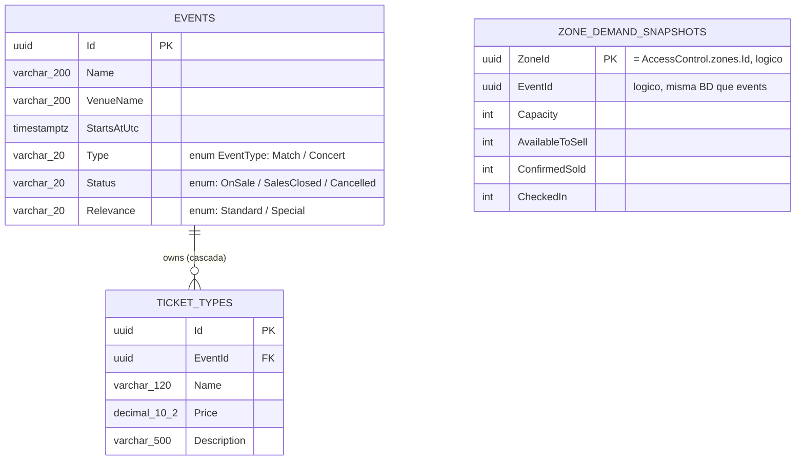
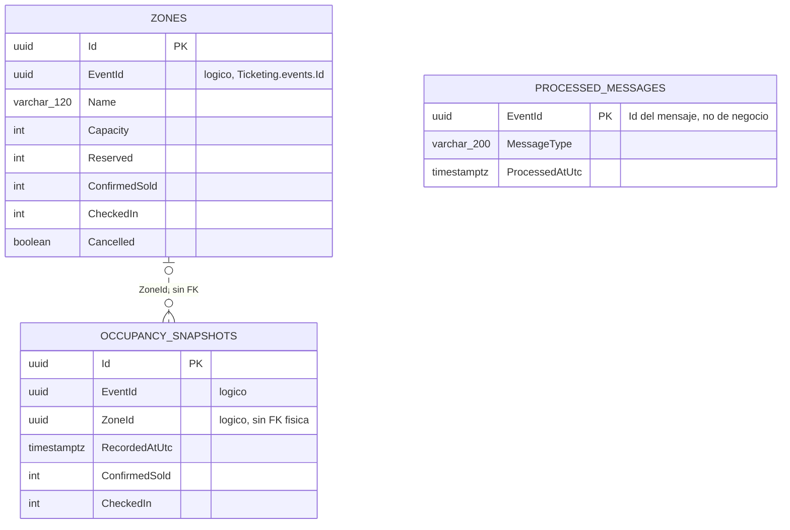
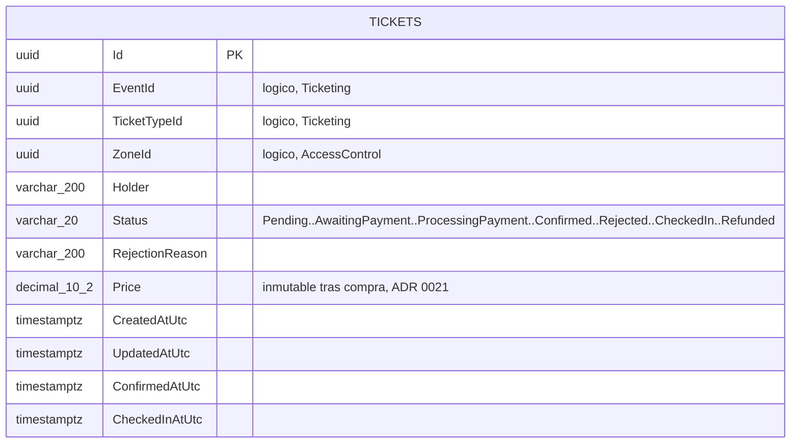
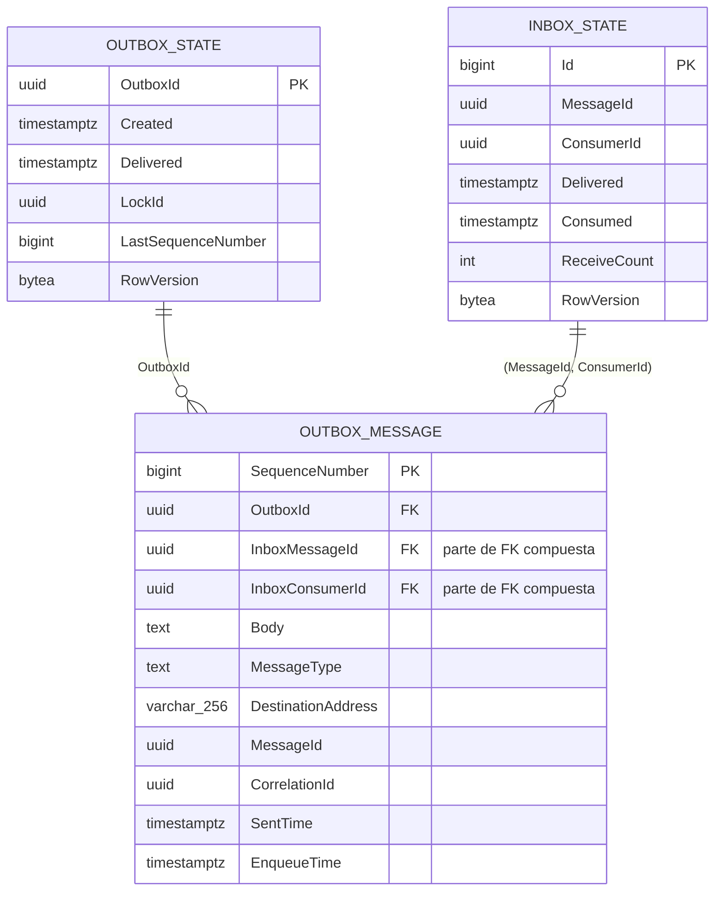
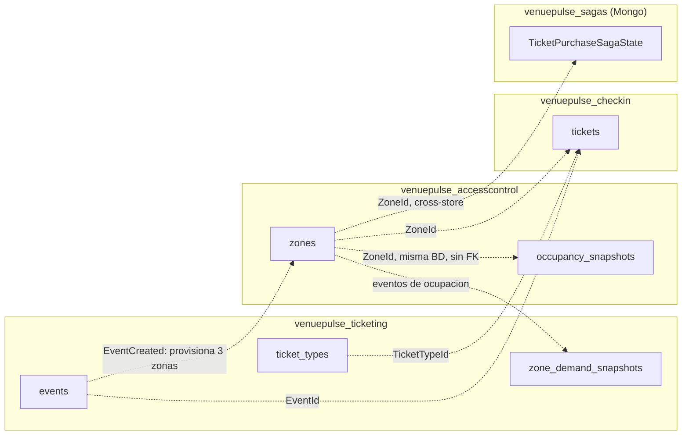

# Diagrama de base de datos — VenuePulse

VenuePulse sigue el patrón **database-per-service**: tres bases PostgreSQL independientes (una
por microservicio) más una colección MongoDB para el estado de la Saga, sin ningún esquema
compartido. No existen claves foráneas físicas entre servicios — la consistencia entre ellos se
logra de forma asíncrona vía eventos de integración (RabbitMQ / MassTransit). Ver
`.ia/ARCHITECTURE.md` y ADR 0005.

| Base de datos | Motor | Servicio | Propósito |
|---|---|---|---|
| `venuepulse_ticketing` | PostgreSQL 16 | Ticketing | Catálogo de eventos y tipos de entrada |
| `venuepulse_accesscontrol` | PostgreSQL 16 | AccessControl | Zonas y aforo por puerta, histórico de ocupación |
| `venuepulse_checkin` | PostgreSQL 16 | CheckIn | Entradas emitidas y su ciclo de vida (compra → check-in) |
| `venuepulse_sagas` | MongoDB | CheckIn | Estado de la saga de compra (`TicketPurchaseSagaState`), documento de forma variable |

## Ticketing — `venuepulse_ticketing`

Dueño del catálogo: eventos y sus tipos de entrada. `ticket_types` es una owned entity de
`Event` — se persiste y se borra en cascada junto al evento dueño, no es un agregado
independiente.

- `ticket_types` no tiene ciclo de vida propio: es una colección owned de `Event` (borrado en
  cascada implícito).
- `zone_demand_snapshots` es una tabla de proyección de lectura alimentada por eventos de
  integración desde AccessControl; su PK (`ZoneId`) es la clave de otra base de datos — no hay
  FK física, solo correlación por `Guid`.

## AccessControl — `venuepulse_accesscontrol`

Aforo por zona/puerta, scoped por evento. No usa el patrón Outbox/Inbox de MassTransit:
implementa su propio inbox idempotente manual (`processed_messages`, ADR 0015).

- `AvailableToSell` es una propiedad calculada (`Capacity - Reserved - ConfirmedSold`), no se
  persiste como columna.
- Índice único compuesto `(EventId, Name)` en `zones`; índice compuesto
  `(EventId, RecordedAtUtc)` en `occupancy_snapshots`.
- `occupancy_snapshots` es la serie temporal del motor de simulación — sin navegación EF hacia
  `zones`, solo el `Guid`.

## CheckIn — `venuepulse_checkin`

Único servicio con CQRS/MediatR. Dueño del agregado `Ticket` y de la `TicketPurchaseSaga` (esta
última persistida aparte, en MongoDB).

- `tickets` es la única tabla de dominio de este servicio; sus tres referencias (`EventId`,
  `TicketTypeId`, `ZoneId`) apuntan a agregados de otros microservicios — EF Core no las modela
  como FK relacional.
- `CreatedAtUtc` / `UpdatedAtUtc` los rellena el `AuditingSaveChangesInterceptor` vía la interfaz
  `IAuditable` (ADR 0011).

## Infraestructura de mensajería (MassTransit)

Mismo esquema Outbox/Inbox transaccional, replicado físicamente en `venuepulse_ticketing` y
`venuepulse_checkin` (ADR 0002). AccessControl no lo usa — tiene su propio inbox manual
(`processed_messages`, ver arriba).

## Relaciones entre bases de datos (event-driven, sin FK física)

Cada base de datos es opaca para las demás. Lo que en un monolito sería una FK aquí es una copia
de `Guid` mantenida por consistencia eventual, propagada por eventos de integración.

**Convención:** línea sólida = FK física, misma base de datos, integridad referencial
garantizada por Postgres. Línea discontinua = referencia lógica por `Guid`, entre bases de datos
(o sin FK declarada); consistencia eventual vía eventos de integración.

---

Generado a partir de los `DbContext`, entidades de dominio y migraciones EF Core bajo
`services/*/Domain` e `Infrastructure` (estado del repo al 2026-08-10). Referencias: ADR 0002
(Outbox/Inbox), ADR 0005 (persistencia poliglota), ADR 0011 (auditoría), ADR 0015 (inbox manual
AccessControl), ADR 0021 (precio inmutable del ticket).
